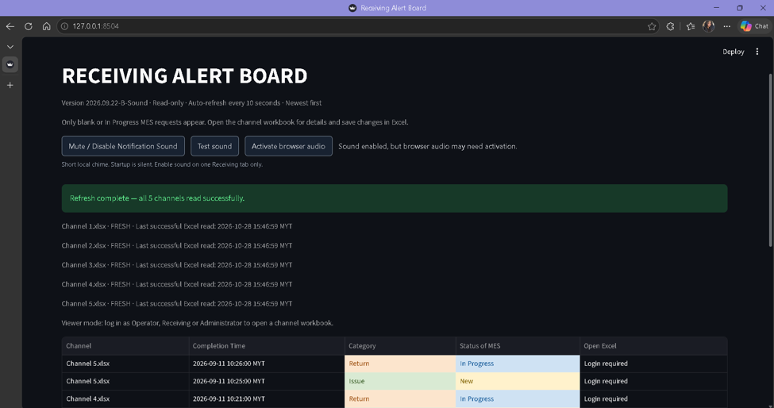
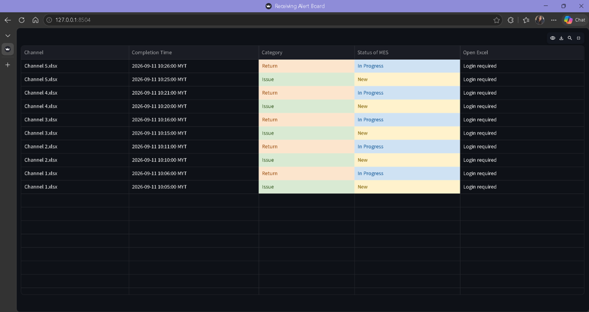
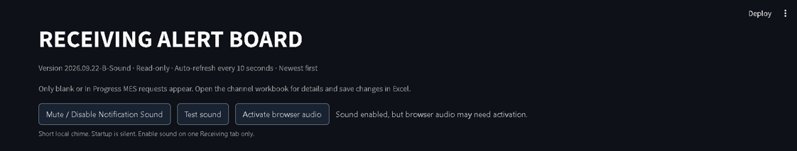

# Receiving Live Board

**A Python and Streamlit dashboard for monitoring material requests across multiple Excel workbooks.**

This project was developed during a manufacturing internship to help a Receiving
team identify requests that need attention. This repository presents the project
overview and demonstration screenshots. The source code is maintained privately.
All records shown here are fictional demonstration data.

## The problem

Requests recorded in separate production-channel workbooks can be difficult to
monitor together. Staff need to know which channel requires attention, when a
request arrived and its current processing status, while continuing to maintain
the full request details in Excel.

## The solution

The Receiving Live Board reads configured local Excel workbooks and brings active
requests into one automatically refreshed view. Staff use the board to identify
the relevant channel, then open its workbook to check details and update progress.
Excel remains the source of truth; the dashboard reads request data without
modifying the original workbooks.

## Main features

- **Multi-channel monitoring:** combines active requests from up to 20 configured
  workbooks into a single dashboard.
- **Focused alert table:** displays Channel, Completion Time, Category and Status
  of MES, with newest requests first.
- **Automatic refresh:** checks saved local workbook data every ten seconds.
- **Status-based visibility:** keeps requests requiring attention visible and
  removes completed or otherwise inactive requests from the display.
- **Notification sound:** alerts staff to newly detected active requests, with
  mute controls and hourly reminders while muted.
- **Independent channel recovery:** continues showing available channels when
  another source cannot be read, with clear stale-data warnings.
- **Configurable sources:** authorized users can select a local folder and the
  worksheet to read in each workbook.
- **Interactive table:** supports sorting, column sizing, pinning, hiding columns
  and viewing statistics through the existing Streamlit table controls.
- **Local role-based access:** separates viewing, opening source workbooks,
  source configuration and account administration.

## Demonstration screenshots

These are actual captures of the existing application running with fictional
sample workbooks. They are not mockups or screenshots of factory production data.

### Main Receiving Live Board

The overview combines monitoring information, source health and active requests
from five fictional production channels.



### Material request tracking

The table identifies the source channel and shows request time, Issue/Return
category and MES status. Blank source statuses appear as New in the display.



### Notification controls

The local browser sound controls let staff test or mute alerts. This screenshot
also shows the browser audio activation prompt: a user interaction may be needed
before sound can play. New-request detection avoids playing a sound repeatedly
for the same unchanged requests.



## Technologies used

| Technology | Application |
| --- | --- |
| Python | Application logic, source configuration and data processing |
| Streamlit | Live dashboard, interactive table and account views |
| pandas | Filtering, combining and sorting request data |
| openpyxl | Reading saved Excel workbook data |
| SQLite | Local account and session storage |
| argon2-cffi | Password hashing |
| HTML, CSS and JavaScript | Notification control interface |
| Web Audio API | Generating the short local notification chime |
| pytest and Streamlit AppTest | Automated Python and interface regression tests |
| Playwright | Browser behavior checks used during development |

## High-level architecture

```text
Local Excel workbooks
        |
        v
Read-only workbook snapshots
        |
        v
Validate, filter and combine active requests
        |
        v
Streamlit Receiving Live Board
        |
        +--> Interactive request table
        +--> Channel health and stale-data indicators
        +--> New-request notification sound

Local account controls govern access to privileged dashboard actions.
Staff continue editing request details in Excel.
```

## Skills demonstrated

- Translating an operational workflow into a focused dashboard.
- Structuring Python code into reader, configuration, presentation and account
  responsibilities.
- Processing multiple Excel sources and handling inconsistent or unavailable data.
- Implementing stable request detection across periodic refreshes.
- Designing permission checks and local account-management workflows.
- Writing automated regression tests and checking read-only behavior.
- Documenting setup, limitations and user testing procedures.

## Verification

The local portfolio preparation run on 29 October 2026 completed **208 Python
tests successfully**. A separate sample-pipeline check read five workbooks,
produced ten active alerts and confirmed that their contents were unchanged
after reading. The images above show the fictional sample interface.

These checks demonstrate tested behavior, not a claim of production acceptance,
complete security certification or measured factory efficiency gains.

## Scope and limitations

This version runs on a local Windows PC and reads saved Excel data. It does not
recalculate Excel formulas. Open-in-Excel actions operate on the PC running the
application and depend on that user's workbook permissions.

Direct Microsoft Graph, SharePoint-link reading and Power Automate integrations
are not implemented. A locally synchronized OneDrive/SharePoint folder can be
read, but synchronization delay is separate from the dashboard refresh interval.
The ten-second interval does not guarantee that cloud changes arrive within one
minute. The dashboard is not presented as a public hosted service.

## Possible future improvements

- An approved direct cloud-data connection.
- Clearer monitoring of cloud-to-local synchronization freshness.
- More reproducible dependency installation and broader deployment testing.
- Further usability testing with different display sizes and operational workflows.

These are potential improvements rather than completed features.

## Repository scope

This is a documentation-only portfolio showcase. It contains this overview and
three demonstration screenshots; it does not contain application source code,
workbooks, credentials, account records or an executable demo. No installation
is required to view it. The source repository is private, and this showcase does
not grant access to it or offer an open-source licence.
